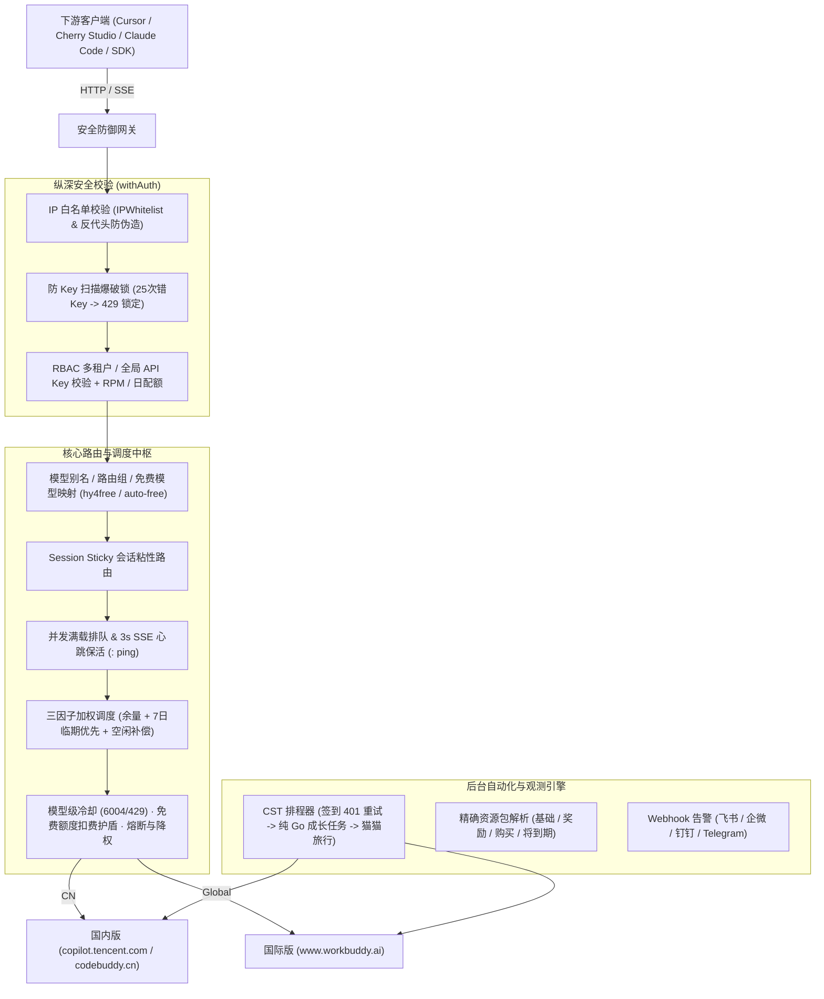

# WorkBuddy 2API · 完整用户与架构开发手册 (`v1.2.52`)

<p align="center">
  <b>将 WorkBuddy / CodeBuddy 多账号汇聚为标准 OpenAI / Anthropic 兼容接口的生产级双域智能网关</b><br>
  双域余额与积分明细 · AI 接口 IP 白名单防扫描 · 免费额度防扣费护盾 · 纯 Go 自动任务与猫猫旅行 · 排队 SSE 心跳保活 · 视频大模型代理 · DeepSeek Harness 内嵌
</p>

<p align="center">
  
  
  
  
  
  
</p>

---

## 目录 (Table of Contents)

- [1. 项目简介与定位](#1-项目简介与定位)
- [2. 系统架构与核心特性全览 (v1.2.52)](#2-系统架构与核心特性全览-v1252)
- [3. 多环境安装与部署指南](#3-多环境安装与部署指南)
  - [3.1 Windows 原生桌面客户端（WebView2）](#31-windows-原生桌面客户端webview2)
  - [3.2 Docker / Docker Compose 部署](#32-docker--docker-compose-部署)
  - [3.3 源码构建与跨平台编译](#33-源码构建与跨平台编译)
  - [3.4 应用内检查更新与热升级](#34-应用内检查更新与热升级)
- [4. 前台门户与新版 Console 控制台详解](#4-前台门户与新版-console-控制台详解)
  - [4.1 前台门户 (`/`)](#41-前台门户-)
  - [4.2 新版 Console 控制中枢 (`/console` / `/dashboard`)](#42-新版-console-控制中枢-console--dashboard)
  - [4.3 账户余额与双域积分明细体系 (v1.2.49–v1.2.50)](#43-账户余额与双域积分明细体系-v1249v1250)
- [5. 纵深安全防御体系](#5-纵深安全防御体系)
  - [5.1 AI 接口 IP 白名单与运行 IP 面板 (v1.2.51)](#51-ai-接口-ip-白名单与运行-ip-面板-v1251)
  - [5.2 错 Key 爆破防扫描与登录频控 (`authRateLimiter`)](#52-错-key-爆破防扫描与登录频控-authratelimiter)
  - [5.3 单机免密 vs Web 管理密码与安全响应头](#53-单机免密-vs-web-管理密码与安全响应头)
- [6. 双域融合调度、免费模型护盾与同邮箱多渠道隔离](#6-双域融合调度免费模型护盾与同邮箱多渠道隔离)
  - [6.1 国内版 (CN) 与国际版 (Global) 双域容灾](#61-国内版-cn-与国际版-global-双域容灾)
  - [6.2 免费模型路由修正与扣费/超额自动熔断 (v1.2.47–v1.2.48)](#62-免费模型路由修正与扣费超额自动熔断-v1247v1248)
  - [6.3 同邮箱跨渠道多账号隔离 (`Google / Twitter / GitHub`)](#63-同邮箱跨渠道多账号隔离-google--twitter--github)
- [7. 多租户 RBAC、配额与 Memory-First 持久化](#7-多租户-rbac配额与-memory-first-持久化)
- [8. 自动签到、纯 Go 成长任务引擎与猫猫旅行](#8-自动签到纯-go-成长任务引擎与猫猫旅行)
  - [8.1 每日定时排程与启动顺序联动（CST 北京时间）](#81-每日定时排程与启动顺序联动cst-北京时间)
  - [8.2 签到 401 强刷重试与控制台实时状态展示 (v1.2.52)](#82-签到-401-强刷重试与控制台实时状态展示-v1252)
  - [8.3 内置纯 Go 成长任务与猫猫旅行引擎 (v1.2.44–v1.2.46)](#83-内置纯-go-成长任务与猫猫旅行引擎-v1244v1246)
- [9. DeepSeek Harness (`dsh`) 智能体集成](#9-deepseek-harness-dsh-智能体集成)
- [10. 全模态视觉推理与专属视频大模型矩阵](#10-全模态视觉推理与专属视频大模型矩阵)
  - [10.1 视觉与多格式文档解析](#101-视觉与多格式文档解析)
  - [10.2 语言、免费与专属视频模型目录](#102-语言免费与专属视频模型目录)
- [11. 客户端接入实战与 HTTP API 端点参考](#11-客户端接入实战与-http-api-端点参考)
  - [11.1 OpenAI / Anthropic / 视频接口示例](#111-openai--anthropic--视频接口示例)
  - [11.2 完整 HTTP 路由表](#112-完整-http-路由表)
- [12. 配置全集与环境变量参考 (`config.json` / `WB2A_*`)](#12-配置全集与环境变量参考-configjson--wb2a_)
- [13. 底层调度与熔断机制原理](#13-底层调度与熔断机制原理)
- [14. 常见问题排查 (FAQ)](#14-常见问题排查-faq)
- [15. 版本演进与开源许可](#15-版本演进与开源许可)

---

## 1. 项目简介与定位

`workbuddy2api` 是针对腾讯云 **CodeBuddy（国内版）** 与 **WorkBuddy AI（国际版）** 生态打造的高可用 AI 协议转换与账号池调度网关。它将多账号凭证整合为单一的本地或私有化接口集群，原生兼容 **OpenAI (`/v1/chat/completions`, `/v1/models`, `/v1/videos/*`)** 与 **Anthropic (`/v1/messages`)** 协议，可直接接入 Cherry Studio、Cursor、Cline、Roo Code、NextChat、Dify、OneAPI / NewAPI 等各类客户端与中继平台。

---

## 2. 系统架构与核心特性全览 (v1.2.52)



---

## 3. 多环境安装与部署指南

### 3.1 Windows 原生桌面客户端（WebView2）
1. 前往 [Releases](https://github.com/XCool-603/wrokbuddy2api/releases) 下载 `workbuddy2api.exe`。
2. 放置到单独目录下直接双击运行：程序自动生成默认 `config.json` 与 `./auths`、`./data` 目录，并拉起内置 Edge WebView2 桌面窗口。
3. 关闭窗口时触发优雅停机，自动将账号池状态、指标快照落盘至 `./data/state.json`。

### 3.2 Docker / Docker Compose 部署
```bash
git clone https://github.com/XCool-603/wrokbuddy2api.git workbuddy2api
cd workbuddy2api
cp config.example.json config.json
docker compose up -d
```
常用运维命令：
```bash
docker compose logs -f workbuddy2api          # 实时查看日志
curl -s http://127.0.0.1:7863/healthz         # 健康检查
docker compose --profile agent up -d          # 连同 dsh Agent 一起启动
```

### 3.3 源码构建与跨平台编译
要求 Go `1.22+`（项目 `go.mod` 为 `go 1.22.5`）：
```bash
# Windows 桌面 GUI 版（隐藏命令行黑框）
go build -ldflags="-s -w -H windowsgui" -o workbuddy2api.exe ./cmd/server

# 无头服务端版（Windows / Linux / macOS）
go build -ldflags="-s -w" -o workbuddy2api-headless ./cmd/server
```

### 3.4 应用内检查更新与热升级
控制台左上角版本徽章（如 `v1.2.52`）支持一键检测 GitHub Release 更新（`/ui/system/update/check`）并执行在线下载替换平滑升级（`/ui/system/update/do`）。

---

## 4. 前台门户与新版 Console 控制台详解

### 4.1 前台门户 (`/`)
根路径 `/` 为对外展示的极客门户页面，通过免鉴权的脱敏接口 `/ui/public/status` 展示网关在线状态、当前版本、就绪账号数、模型总数及 cURL / Python / Node.js / Go / Claude / 视频接入代码示例，右上角提供「进入控制台」直达入口。

### 4.2 新版 Console 控制中枢 (`/console` / `/dashboard`)
自 `v1.2.50` 起控制台经过全面精简重构，消除多行按钮堆积，划分为五个主标签页：
1. **账号池矩阵**：
   - 顶部 **6 项精简 KPI 卡片**：总账号资产、健康可调度、限流冷却中、异常/停用、会话粘性、在途满载。
   - 紧随其后的 **「账户余额与双域额度摘要条」**：一行展示全池余额、CN 余额、Global 余额、同步覆盖数、**今日自动签到状态胶囊**，以及右侧两个核心弹窗按钮 **「💰 账户余额」** 与 **「📊 积分明细」**。
   - **账号矩阵工具栏**：支持 **`全部 / CN / Global`** 域筛选切换；右侧收敛为 `授权国内版`、`授权国际版`、`导入 / 备份 ▾`、`🎁 一键吃满福利`、`更多任务 ▾`（派猫猫、成长任务、签到、试用包、邀请指南）。
   - **账号行操作列**：每行简化为 **`余额`**、**`明细`** 与悬浮 **`操作 ▾`** 菜单（领福利、做任务、派猫猫、重填 Token、解除冷却/复活、启用/停用、删除）。
2. **客户端接入 & Key**：配置 API Key、控制台管理密码、**🛡️ AI 接口 IP 白名单与运行 IP**，以及查看全部可路由聚合模型列表（含多模态/视频/倍率徽章及模型级可用数）。
3. **用量分析看板**：按日持久化统计（`./data/metrics.json`）消耗积分、单次平均积分、Prompt/Completion Token、缓存命中率、请求成功率与分模型消耗表。
4. **在线调试 & 流水**：内置流式对话 Playground（支持附件与 `Ctrl+V` 截图粘贴）与最近请求流水表。
5. **Agent (dsh) & 用户权限管理**：管理内嵌 `@deepseek-ai/dsh` 进程与多租户账号、配额、RPM 限制。

### 4.3 账户余额与双域积分明细体系 (`v1.2.49` – `v1.2.50`)
后端通过 `upstream.Client.UserResourceBreakdown` 解析官方 `/billing/meter/get-user-resource` 返回的全部包明细（优先读取 `*Precise` 精确小数字符串）：
- **分类统计**：
  - **`base`（套餐基础积分）**：识别 `SubProductCode == "sp_tcaca_codebuddy_ide"` 或体验版/套餐名；
  - **`bonus`（平台奖励积分）**：识别 `sp_tcaca_codebuddyide_bonus_pack`、权益/拉新/奖励包；
  - **`purchased`（购买积分）**：其余付费购买资源包；
  - **`expiring_remain`（7日内到期）**：`CycleEndTime` 在 7 天窗口内的活跃剩余积分。
- **双快捷弹窗**：
  - 点击 **`💰 账户余额`** 打开 `#balanceOverviewModal`：按全池 / CN / Global 三栏对比总余量/累计总额/已消耗与健康账号数，并支持分账号余量表高亮定位。
  - 点击 **`📊 积分明细`** 打开 `#creditDetailOverviewModal`：支持切换 `🌐 全池 / 🇨🇳 CN / 🌍 Global`，查看 6 项积分分桶指标、域内模型限流与实测单价表（`cost_per_1k`），并可钻取单个账号的 `#creditDetailModal` 查看其全部资源包明细（名称、代码、分类、生效状态、余量进度、到期时间）。

---

## 5. 纵深安全防御体系

### 5.1 AI 接口 IP 白名单与运行 IP 面板 (`v1.2.51`)
实现位于 `internal/server/ip_whitelist.go`：
- **保护范围**：覆盖 `withAuth` 包裹的全部 AI 与管理 API 端点（`/v1/chat/completions`、`/v1/messages`、`/v1/videos/*`、`/v2/videos/*`、`/v1/models`、`/status`、`/v1/stats*`、`/admin/*`）。
- **规则支持**：支持单个 IPv4/IPv6（如 `203.0.113.10`）及 CIDR 网段（如 `192.168.1.0/24`、`2001:db8::/32`），保存前使用 `net/netip` 严格校验格式，未命中请求直接返回 HTTP `403`（`ip_not_allowed`）。
- **防转发头伪造 (`extractTrustedClientIP`)**：仅当直连 TCP 对端 (`r.RemoteAddr`) 属于本机回环或私网/链路本地代理地址时，才采信 `X-Forwarded-For` / `X-Real-IP`；若直接暴露在公网收到外网连接，一律只认真实 `RemoteAddr`，杜绝攻击者伪造 `X-Forwarded-For: 127.0.0.1` 绕过白名单。
- **本机回环策略**：默认 `allow_localhost: true`，避免本机工具、Playground 或容器健康检查误锁，也可显式关闭。
- **运行 IP 实时展示**：控制台 **「客户端接入 & Key」** 实时展示服务监听地址（`listen_addr`）、宿主机网卡运行 IP（`running_ips`）与当前访问端 IP（`client_ip`），支持一键点击 **「+ 加入白名单」**，保存后同步持久化至 `./data/settings.json` 与 `config.json`。

### 5.2 错 Key 爆破防扫描与登录频控 (`authRateLimiter`)
- **API 接口防扫描**：同一 IP 在 2 分钟内向 `/v1/*` 等接口连续提交 **25 次错误 API Key**，自动锁定该 IP 2 分钟（返回 HTTP `429 rate_limit_exceeded`）。
- **控制台登录防爆破**：同一 IP 在 5 分钟内连续输错 Web 密码 **5 次**，自动锁定 5 分钟；注册接口每 10 分钟限制同一 IP 最多注册 5 次。

### 5.3 单机免密 vs Web 管理密码与安全响应头
- `web_password` 为空时进入单机免密模式（直接具备管理员权限）；设置 6 位以上密码后即激活全控制台鉴权，签发 24 小时有效期 `wb2a_session` Cookie（持久化于 `./data/`）。
- 全站响应自动注入 `X-Content-Type-Options: nosniff`、`X-Frame-Options: SAMEORIGIN`、`X-XSS-Protection: 1; mode=block`、`Referrer-Policy`、`Permissions-Policy`。

---

## 6. 双域融合调度、免费模型护盾与同邮箱多渠道隔离

### 6.1 国内版 (CN) 与国际版 (Global) 双域容灾
- **国内版 (CN)**：对接 `copilot.tencent.com` 与 `www.codebuddy.cn`。
- **国际版 (Global)**：对接 `www.workbuddy.ai`（支持无 `/v2` 优先路径并在 404 时兼容 `/v2` fallback）。
- 网关支持模型前缀路由（`cn:...` / `global:...`）以及默认双域智能容灾。当某域下仅特定后缀可用时自动按配置优先挑选对应健康池节点；若需要严格锁定纯 CN 运行，可将 `global.enabled` 设为 `false`。

### 6.2 免费模型路由修正与扣费/超额自动熔断 (`v1.2.47` – `v1.2.48`)
- **`hy4free` 直连免费节点 (`v1.2.47`)**：修复原先将 `hy4free` 重写到付费预览模型 `hy4-preview` 导致持续扣除积分的问题，`hy4free`（及 `global:hy4free`）现在直接命中官方免费端点 `hy4free`（`x0.00`）。
- **免费模型实时扣费熔断 (`v1.2.48`)**：针对免费层模型（如 `hy4free`、`deepseek-v4.1-flash`、`glm-4-flash`、`freeModels` 列表模型），每次上游流返回 `usage.credit > 0` 或 `usage.quota.percent >= 100` 时，立即调用 `Pool.CooldownFreeQuotaModel` 将该账号的该模型冷却至官方重置窗口，并在请求层触发自动切换下一个健康账号（若全部免费账号额度耗尽则返回 `429`），彻底防止免费模型悄悄花光付费积分。

### 6.3 同邮箱跨渠道多账号隔离 (`Google / Twitter / GitHub`)
国际版中同一邮箱可通过 Google、Twitter/X、GitHub 等渠道分别注册登录。系统内置指纹识别与文件名分流（如 `workbuddy-global-google-xxx.json`、`workbuddy-global-twitter-xxx.json`），在内存调度池内独立分配账号槽位、并发计数与积分状态，向上游发包时再还原原始 `X-User-Id` 邮箱，消除账号相互覆盖冲突。

---

## 7. 多租户 RBAC、配额与 Memory-First 持久化

- **Admin（管理员）**：全局管控所有公共/私有账号池、IP 白名单、全局 API Key、系统升级与全部租户管理。
- **User（普通用户）**：拥有独立生成和可重置的专属 API Key；请求只路由到属于该用户自己名下的账号或系统公共账号；支持为每个租户单独设置 **每日积分配额（Daily Credit Quota）** 与 **每分钟请求频控（RPM）**。
- **Memory-First 容错**：用户与密钥写操作优先实时生效于内存并原子写入 `./data/users.json` 与 `./data/settings.json`，即使宿主机目录遭遇瞬时写权限限制也不会中断鉴权服务；可选配合 Upstash Redis 做跨实例状态镜像。

---

## 8. 自动签到、纯 Go 成长任务引擎与猫猫旅行

### 8.1 每日定时排程与启动顺序联动（CST 北京时间）
`internal/scheduler` 所有触发时刻严格按 **北京时间（CST UTC+8）** 计算，容器部署在 UTC 时区也无 8 小时漂移。服务启动 3 秒后自动按序联动执行：
1. **每日签到与余额刷新**（`CheckinHours` 默认 `[9, 21]`）
2. **全量成长任务与 5 连对话门槛解锁**（`TasksHours` 默认 `[11]`）
3. **猫猫旅行巡检与首次自动领养**（`TravelHours` 默认 `[9, 21]`）

其余独立排程包括：`ActivityHours`（`[10]`，活跃上报与连登奖励兑换/抽奖）、`KeepaliveHours`（`[22]`，Token 定时保活刷新）、`SchoolHours`（`[12]`）、`CatHours`（`[1]`）。

### 8.2 签到 401 强刷重试与控制台实时状态展示 (`v1.2.52`)
- **为什么官方全球版不参与签到**：仅国内版（CN）支持 `/v2/billing/meter/daily-checkin` 每日签到（每次约 +6~+10 积分）；国际版（Global）官方无每日签到，调度器自动标记为 `skipped (global)`。
- **Token 提前失效自愈**：`CheckinAll` 与手动 `POST /ui/action/signin` 遇 HTTP `401` 或 `ErrSessionDead` 时，不再直接失败，而是自动强刷 `RefreshToken` 并重放签到请求一次。
- **今日状态实时回显**：[internal/pool/checkin.go](internal/pool/checkin.go) 按 CST 自然日记录每号与全池签到摘要（次日 00:00 自动刷新为待签），控制台摘要条实时展示 **`✓ 今日已签 X/Y CN · 下次 HH:MM`**，账号状态列显示 `✓ 今日已签` 或 `✗ 签到失败`。

### 8.3 内置纯 Go 成长任务与猫猫旅行引擎 (`v1.2.44` – `v1.2.46`)
- **免 Python 原生运行 (`internal/upstream/tasks.go`)**：当独立二进制环境缺少 `python` 或 `scripts/task_runner.py` 时，自动使用内置纯 Go 引擎执行全量成长任务。
- **任务覆盖与状态核验**：支持按官方任务清单核对完成进度并主动领取已达成奖励，覆盖技能分享（`skill_share_entry_click` + `skill_share_channel_action`）、腾讯云轻量云专家（`Expert_lighthouse`）、发现应用（`Buddy_App`）、5 个模板对话（`template_5`）、微信公众号关注任务（`wb_wechat_oa_subscribe_task`）等。
- **猫猫领养与旅行**：先补齐 5 连活跃对话解锁门槛，再调用 `BuddyFirst` 自动领养第一只猫（+300 积分），并定时巡检到站领奖、重新派出。

---

## 9. DeepSeek Harness (`dsh`) 智能体集成

- **一键绿色环境安装**：控制台「Agent (dsh)」标签支持自动拉取并安装便携式 Node.js 运行时与 `@deepseek-ai/dsh`。
- **内嵌反向代理与鉴权穿透**：`internal/dshmgr` 管理子进程并在 `/ui/dsh/*` 与 Web 控制台间代理流量。
- **虚拟模型 `dsh` 直连**：启动或安装就绪后，`/v1/models` 会暴露 `dsh` 虚拟模型，外部客户端可直接选取 `dsh` 发起对话。

---

## 10. 全模态视觉推理与专属视频大模型矩阵

### 10.1 视觉与多格式文档解析
- 支持 OpenAI `type: "image_url"`（含远程图片抓取转 Base64 Data URL 与本地 Data URL）及 Anthropic `type: "image"`（Base64）。
- 支持文本与代码文件（`.txt` / `.md` / `.pdf` / `.json` / `.csv` / 源码）自动抽取并清洗为上下文。

### 10.2 语言、免费与专属视频模型目录
具体可用模型由账号池启动及运行期向国内版与国际版上游实时探测动态聚合，并通过模型开关、别名字典（`model_aliases`）及路由组（`model_routes`）扩展：
- **代表性语言 / 推理 / 免费模型**：`hy4free`（官方免费节点 `x0.00`）、`deepseek-v4.1-flash`、`deepseek-v4-flash`、`deepseek-v3`、`deepseek-r1`、`glm-5.3`、`glm-4-flash`、`kimi-k3-1`、`kimi-k2.8`、`minimax-m3`、国际版 `gpt-*` / `gemini-*` 等，支持虚拟路由池 `auto-free`。
- **专属视频模型（仅国内版 CN 支持）**：
  - `kling-video-v3`（兼容别名 `kling-v3`、`kling`、`keling`、`kling-v3-t2v`、`kling-v3-i2v`）：快手可灵 3.0，支持文生/图生视频与 720P / 1080P / 4K。
  - `minimax-video-h3`（兼容别名 `hailuo-video`）：MiniMax 海螺视频，支持 768P / 2K 与自适应 / 21:9 画幅。
  - 同时支持专用异步端点及在 `/v1/chat/completions` 对话窗口中直接桥接输出 MP4 直链卡片。

---

## 11. 客户端接入实战与 HTTP API 端点参考

### 11.1 OpenAI / Anthropic / 视频接口示例
- **OpenAI Base URL**: `http://<主机>:7863/v1`
- **Anthropic Messages API**: `POST http://<主机>:7863/v1/messages`（兼容 Claude Code 等 Anthropic 客户端，支持 `x-api-key` 或 `Authorization: Bearer`）

```bash
# 1. OpenAI 标准流式对话
curl -N http://127.0.0.1:7863/v1/chat/completions \
  -H "Authorization: Bearer sk-workbuddy2api" \
  -H "Content-Type: application/json" \
  -d '{"model":"hy4free","messages":[{"role":"user","content":"Hello"}],"stream":true}'

# 2. Anthropic /v1/messages 兼容调用
curl -N http://127.0.0.1:7863/v1/messages \
  -H "x-api-key: sk-workbuddy2api" \
  -H "Content-Type: application/json" \
  -d '{"model":"claude-3-7-sonnet","max_tokens":1024,"messages":[{"role":"user","content":"你好"}],"stream":true}'

# 3. 异步视频生成与查询
curl -X POST http://127.0.0.1:7863/v1/videos/generations \
  -H "Authorization: Bearer sk-workbuddy2api" \
  -H "Content-Type: application/json" \
  -d '{"model":"kling-video-v3","prompt":"无人机航拍雪山日出，电影质感","duration":5,"resolution":"1080P"}'
```

### 11.2 完整 HTTP 路由表

| 分类 | 方法与路径 | 鉴权方式 | 说明 |
| :--- | :--- | :---: | :--- |
| **门户与健康** | `GET /`、`GET /ui/public/status`、`GET /healthz` | 公开 | 赛博门户页、脱敏健康指标、存活性探针 |
| **控制台页面** | `GET /console`、`GET /dashboard` | 页面直出 + API 鉴权 | Web 管理控制台静态外壳（`no-store`） |
| **AI 核心推理** | `POST /v1/chat/completions`、`POST /v1/messages`、`GET /v1/models` | `withAuth` (IP白名单+Key+配额) | OpenAI/Anthropic 对话与视频桥接、动态模型清单 |
| **视频生成** | `POST /v1/videos/generations`、`POST /v2/videos/generations`<br>`POST /v1/videos/tasks`、`GET /v1/videos/tasks/{id}` | `withAuth` | 同步/异步视频提交与任务状态轮询 |
| **状态与指标** | `GET /status`、`GET /v1/stats`、`POST /v1/stats/reset` | `withAuth` | 账号池与请求统计快照（重置需 `withAuth`） |
| **运维管理 API** | `POST /admin/accounts/{uid}/{disable,enable,revive}` | `withAuth`（需 `admin.enabled=true`） | 账号启用/停用/复活（未开启时返回 404） |
| **控制台认证** | `POST /ui/auth/login`、`logout`、`register` | 公开（带频控） | Web 会话 Cookie 登录与租户注册 |
| **控制台数据** | `GET /ui/data`、`GET /ui/inflight/data` | `withWebAuth` | 账号池/双域积分汇总/签到摘要/IP白名单/运行IP/在途流 |
| **账号与动作** | `POST /ui/oauth/*`、`/ui/account/*`、`/ui/action/{signin,trial,welfare,travel,tasks,bind_invite,delete}`、`/ui/backup/*` | `withWebAuth` | OAuth 授权、多格式导入导出、福利/任务/猫猫/签到操作 |
| **系统安全设置** | `POST /ui/config/apikey`、`password`、`ip_whitelist` | `withWebAuth` (Admin) | 动态更新并持久化主 Key、控制台密码、IP 白名单 |
| **Agent / 租户 / 升级** | `/ui/dsh/*`、`/ui/admin/user*`、`/ui/system/update/*` | `withWebAuth` | dsh 进程管控、多租户配额管理、应用在线升级 |

---

## 12. 配置全集与环境变量参考 (`config.json` / `WB2A_*`)

### 12.1 完整 `config.json` 示例

```json
{
  "listen": ":7863",
  "api_key": "sk-workbuddy2api",
  "web_password": "",
  "ip_whitelist_enabled": false,
  "allowed_ips": [],
  "allow_localhost": true,
  "auth_dir": "./auths",
  "state_file": "./data/state.json",
  "admin": {
    "enabled": false
  },
  "global": {
    "enabled": true,
    "chat_base": "",
    "billing_base": ""
  },
  "pool": {
    "max_in_flight": 3,
    "max_in_flight_global": 2,
    "breaker_threshold": 3,
    "breaker_cooldown": "30m",
    "breaker_cooldown_max": "6h",
    "degrade_threshold": 5,
    "degrade_cooldown": "10m",
    "degrade_cooldown_max": "2h",
    "idle_weight_per_hour": 0.5,
    "idle_weight_max": 5.0,
    "expiring_soon": "168h",
    "cost_explore_interval": "30m",
    "queue_timeout_seconds": 60
  },
  "cooldown": {
    "soft_rate": "600s",
    "soft_rate_max": "2h"
  },
  "schedule": {
    "checkin_enabled": true,
    "checkin_hours": [9, 21],
    "travel_enabled": true,
    "travel_hours": [9, 21],
    "activity_enabled": true,
    "activity_hours": [10],
    "keepalive_enabled": true,
    "keepalive_hours": [22],
    "school_enabled": true,
    "school_hours": [12],
    "cat_enabled": true,
    "cat_hours": [1],
    "tasks_enabled": true,
    "tasks_hours": [11],
    "activity_report_count": 5
  },
  "session_sticky": {
    "enabled": true,
    "ttl": "30m",
    "gc_interval": "5m"
  },
  "upstream": {
    "timeout_seconds": 120,
    "header_timeout_seconds": 120,
    "idle_timeout_seconds": 300,
    "client_name": "WorkBuddy",
    "passthrough_ip": false,
    "proxy": ""
  },
  "features": {
    "sanitize_blacklist_fingerprints": true
  },
  "prompt": {
    "mode": "passthrough",
    "file": ""
  },
  "alert": {
    "enabled": false,
    "webhooks": [],
    "events": [],
    "min_credit": 100
  }
}
```

### 12.2 环境变量完整对照表 (`cmd/server/config.go`)

| 环境变量 | 对应配置 / 作用 | 说明 |
| :--- | :--- | :--- |
| `WB2A_LISTEN` | `listen` | 监听地址与端口，如 `:7863` |
| `WB2A_API_KEY` | `api_key` | 主 API Key（覆盖文件与 `settings.json`） |
| `WB2A_WEB_PASSWORD` | `web_password` | 控制台登录密码 |
| `WB2A_ALLOWED_IPS` | `allowed_ips` | 逗号分隔的允许 IP/CIDR；非空时默认自动启用白名单 |
| `WB2A_IP_WHITELIST_ENABLED` | `ip_whitelist_enabled` | 显式控制白名单开关（`true`/`1`/`false`/`0`） |
| `WB2A_ALLOW_LOCALHOST` | `allow_localhost` | 是否始终允许本机回环 `127.0.0.1 / ::1` |
| `WB2A_AUTH_DIR` / `WB2A_STATE_FILE` | `auth_dir` / `state_file` | 凭证目录与状态持久化文件路径 |
| `WB2A_ADMIN_ENABLED` | `admin.enabled` | 是否启用 `/admin/accounts/*` 运维 API |
| `WB2A_UPSTREAM_PROXY` / `WB2A_PROXY` | `upstream.proxy` | 出站代理 URL（`http://`/`https://`/`socks5://`） |
| `WB2A_QUEUE_TIMEOUT` / `WB2A_QUEUE_TIMEOUT_SECONDS` | `pool.queue_timeout_seconds` | 并发满载排队超时秒数（默认 `60`） |
| `WB2A_EXPIRING_SOON` | `pool.expiring_soon` | 临期积分判定窗口（默认 `168h` = 7天） |
| `WB2A_SOFT_RATE` / `WB2A_SOFT_RATE_MAX` | `cooldown.soft_rate*` | 429 软冷却基数与退避封顶 |
| `WB2A_TIMEOUT_SECONDS` / `HEADER_*` / `IDLE_*` | `upstream.*` | 上游短 RPC、首字节及流空闲超时 |
| `WB2A_USER_AGENT` / `CLIENT_NAME` / `CLIENT_VERSION` / `CLI_VERSION` | `upstream.*` | 出站指纹头覆盖配置 |
| `WB2A_DEVICE_TOKEN` / `WB2A_DEVICE_TOKEN_FILE` | `upstream.*` | 设备风控 `X-Device-Token` 注入与文件读取 |
| `WB2A_PASSTHROUGH_IP` | `upstream.passthrough_ip` | 是否向官方透传客户端 IP（默认 `false`） |
| `WB2A_SANITIZE_FINGERPRINTS` | `features.sanitize_blacklist_fingerprints` | 出站请求黑名单指纹脱敏开关 |
| `WB2A_PROMPT_MODE` / `WB2A_PROMPT_FILE` | `prompt.mode` / `prompt.file` | `passthrough` / `custom` / `append` 与提示词文件 |
| `WB2A_ALERT_ENABLED` / `WB2A_ALERT_WEBHOOKS` | `alert.*` | Webhook 告警开关与逗号分隔地址列表 |
| `WB2A_MODEL_ALIASES` | `model_aliases` | JSON 字典覆盖模型别名映射 |

---

## 13. 底层调度与熔断机制原理

1. **三因子加权随机调度 + 成本分层**：
   - 基于可用积分余量（$W_{\text{credits}}$）、7 天内临期积分加成（$W_{\text{expiring}}$，优先清零活动限时包）与空闲时长补偿（$W_{\text{idle}}$）计算综合权重。
   - 结合 `ModelCosts`（EMA 实测单价 `cost_per_1k`）优先命中已知免费或低成本通道，并按 `cost_explore_interval` 周期性探测未观测节点。
2. **模型级独立冷却 & 免费额度护盾**：
   - 遭遇 429/6004 或免费模型触发扣费/额度用尽时，仅把 `(账号, 模型)` 条目写入 `modelCooldowns`，不影响同账号其他模型。
   - 指数退避（600s 起步，默认封顶 2h）；连续非账户级异常按 `degrade_threshold` 触发降权；硬性账号故障按 `breaker_threshold` 触发长冷却熔断。
3. **Session Sticky & 排队保活**：
   - 会话签名稳定绑定账号（默认 `30m`），最大化复用上游 Prompt Cache 命中率；满载排队期间每 3s 向 SSE 写入 `: ping` 注释防止下游断连。

---

## 14. 常见问题排查 (FAQ)

### Q1: Docker 部署提示 `open data/users.json.tmp: permission denied` 怎么办？
- 宿主机挂载卷目录 UID 不一致时，在宿主机执行 `chmod -R 777 ./data ./auths`；同时网关启用 Memory-First 策略，新创建/注册用户与密钥会优先在内存中生效。

### Q2: 为什么自动签到看起来像没签？国际版支持每日签到吗？
- **仅国内版（CN）支持每日签到**（每次约 +6~+10 积分）；国际版（Global）官方无每日签到入口，调度器会自动跳过。
- 国内版每日于北京时间 `09:00` 与 `21:00` 及服务启动 3 秒后执行；自 `v1.2.52` 起控制台顶部摘要条会实时展示 **`✓ 今日已签 X/Y CN · 下次 HH:MM`**，账号列表状态列也会显示今日已签回执，遇到 `401` 会自动强刷 `RefreshToken` 并重试。

### Q3: 如何开启 IP 白名单并查看运行 IP 防止别人扫描使用我的 Key？
- 在控制台进入 **「客户端接入 & Key」 -> 「🛡️ AI 接口 IP 白名单 & 运行 IP」**，查看服务网卡运行 IP、监听端口与当前来访客户端 IP；点击 **「+ 加入白名单」** 或输入允许的 IP / CIDR 网段并启用保存，非白名单 IP 将被直接拦截返回 `403`。

### Q4: 免费模型（如 `hy4free`）为什么有时会扣积分或提示 429？
- 若你开启了 `v1.2.47+`，`hy4free` 会直连官方免费节点 `hy4free`（不经过收费的 `hy4-preview`）。自 `v1.2.48` 起，一旦某个账号在任意免费模型上出现 `credit > 0` 扣费或 `quota.percent >= 100`，网关会立刻冷却该账号该模型并切换下一账号；若全池免费账号均已耗尽则会返回 `429` 保护付费积分不被扣光。

### Q5: 批量导入支持哪些格式？
- 支持拖拽或选择多个 `.json` / `.txt` 文件、上传 `.zip` 备份包、C 风格注释宽松 JSON、常见中继导出嵌套 JSON（`data` / `accounts` / `tokens`）以及每行 `accessToken----refreshToken` 卡密格式，导入后自动并发刷新测试并同步余额。

### Q6: 请求出现 503 且提示 `no healthy account available` 怎么排查？
- 检查账号池是否有未过期可用账号（可查看 `💰 账户余额` 及 `运行状态` 列是否全池冷却/禁用）；
- 对国际版账号若长期未用返回 `12153 Invalid refresh token`，需点击操作菜单中的「重填 Token」或重新授权登录；
- 普通租户调用需确认自己名下有可用账号或池内存在公共账号。

### Q7: 视频生成为何仅国内版可用，大概耗时多久？
- 官方目前仅在国内版开放可灵 3.0 与 MiniMax-H3 视频模型，国际版暂无视频路由，网关已自动在路由层严格隔离至 CN 池；
- 生成耗时通常为 30 秒 ~ 3 分钟（高峰期可能达 5~10 分钟），自动化调用建议使用异步模式（不传 `wait: true`）并轮询 `GET /v1/videos/tasks/{id}`。

### Q8: 忘记控制台管理密码如何恢复？
- 编辑 `config.json` 与 `./data/settings.json`（若存在），将 `"web_password"` 设为空字符串 `""` 后重启服务，即可恢复为单机免密模式。

---

## 15. 版本演进与开源许可

- **`v1.2.52`**：每日签到新增 `401` 强刷 Token 重试机制，控制台顶部摘要条与账号列实时显示今日签到状态与下轮时刻。
- **`v1.2.51`**：新增 AI 接口 IP 白名单防扫描（CIDR/单 IP + 防 XFF 伪造）、错 Key 爆破防扫描锁定（25 次/2 分钟 -> `429`）与运行 IP 面板。
- **`v1.2.50`**：Console 页面精简重构，新增顶部「💰 账户余额 / 📊 积分明细」双快捷按钮、域名筛选与每行「余额 / 明细 / 操作 ▾」浮层菜单。
- **`v1.2.49`**：精确资源包拆分解析（套餐基础 / 平台奖励 / 购买积分 / 7日内到期）及全池 / CN / Global 三域汇总面板。
- **`v1.2.47` – `v1.2.48`**：修正 `hy4free` 直连免费端点，落地免费模型扣费/额度耗尽自动限流切号护盾。
- **`v1.2.42` – `v1.2.46`**：新增纯 Go 内置成长任务引擎、单号/批量任务 UI、猫猫自动领养与技能分享等 18+ 项活动任务收割。
- **开源协议**：[MIT License](LICENSE) · 维护者：[XCool-603](https://github.com/XCool-603)
